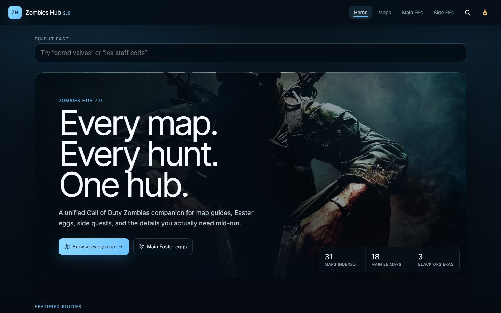
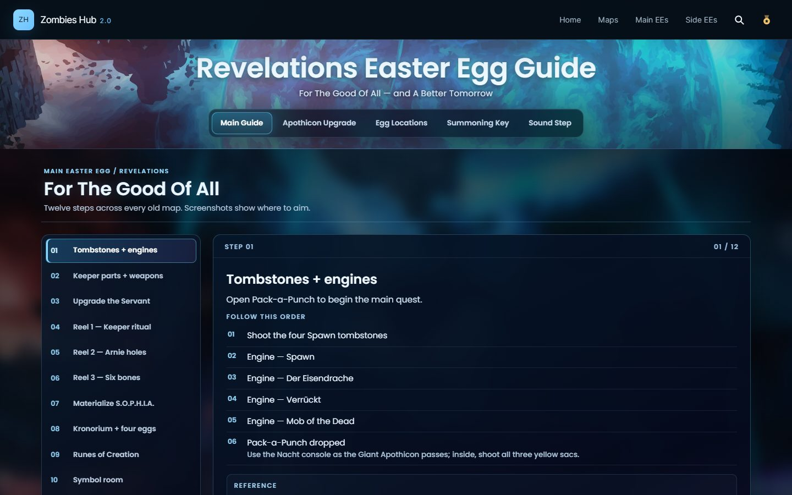
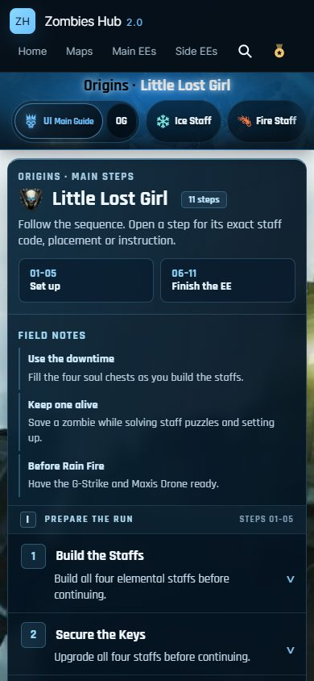
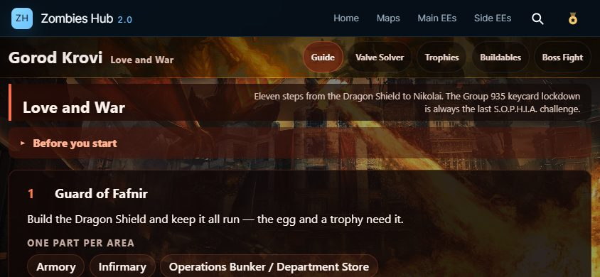

# Zombies Hub 2.0

[](https://github.com/PHTMGatt/Zombies-Hub-2.0/actions/workflows/build.yml)

**A second-screen Call of Duty: Black Ops III Zombies Easter Egg guide. Glance, understand, keep playing.**

**Live:** https://zombies-hub-2-0.onrender.com/ · **Original 1.0 Hub:** https://zombies-hub.onrender.com/

<p align="center">
  
</p>

Built by Bryen ([@PHTMGatt](https://github.com/PHTMGatt)), a Zombies player who got tired of pausing mid-run to scroll a 40-screen wiki page.

Open a map and answer one question fast: **“what do I do next?”** Short steps, the exact picture of where to aim, and the solver or code you need, all on the phone propped next to the controller.

## What you get

- **Seven dedicated Easter Egg guides**: Origins, Mob of the Dead, Shadows of Evil, Der Eisendrache, Zetsubou No Shima, Gorod Krovi and Revelations. Each has its own look, and its own page structure where the mechanics differ.
- **Built for a phone mid-game**: each map's main guide is a flat list (number, title, one short line) you can read in a glance. The depth is one tap away: staff, bow, buildable and solver tabs, plus a **Step details** tab with every warning and how-to line, one section per step. Layouts are tuned for 390×844 portrait, 844×390 landscape and 1440 desktop.
- **Tools, not just text**: Gorod Krovi valve solver, Origins staff puzzle codes and Lightning dial cheat sheet, Der Eisendrache bow upgrades and wisp guide, Zetsubou cog routes, Revelations Apothicon upgrade, egg locations, summoning-key throws and sound-step references.
- **Works offline once opened**: a guide you have visited still loads with no connection (service worker); one you never opened shows a clear "couldn't load" page instead of a blank screen.
- **Show filter** on the map catalog (All maps / Easter Eggs / Full guides) and the Easter Egg list (All quests / Full guides / Video guides).
- **Origins Speed Run companion** in Side EEs: robot and snow routing, cycle strategy, tank and Lightning skips, staff duplication and ending setup.
- **Side Easter Eggs and a 31-map index** across three Black Ops eras.
- **Search** across guides (try “gorod valves” or “ice staff code”) and an **achievements** view.
- **Videos and timestamps** where seeing the spot beats reading about it.
- **Fast and shareable**: WebP cover art, map-card art that loads as it nears the screen, and a page title and meta description that follow every route.

<p align="center">
  
  
</p>
<p align="center">
  
</p>

## 1.0 vs 2.0

Zombies Hub 1.0 was a separate React app and a separate Render service for every map guide, so each jump between maps was a new website with its own cold start. 2.0 is **one React app, one router, one codebase and one Render service**. Guides are internal routes: navigation is fast and each map keeps its identity.

| Zombies Hub 1.0 | Zombies Hub 2.0 |
| --- | --- |
| Separate React app for each guide | **One React application** |
| Separate Render service for each guide | **One Render service** |
| Guide-to-guide website jumps | **Internal React routing** |
| Duplicated app code and dependencies | **Shared guide components and layout** |
| More chances for cold-start delays | **Faster, smoother navigation** |

## Tech

- **React 19**, **Vite 6**, **React Router 7**: a static single-page app
- **Node 22** (the version CI and Render use)
- Per-map CSS is auto-scoped by a PostCSS plugin, so one guide cannot restyle another
- **Playwright** browser smokes at three viewports, plus Node unit tests that guard guide content
- **GitHub Actions** CI, deployed to **Render** from `main` (merge to `main` = production deploy)

## Project structure

```text
Zombies-Hub-2.0/
├── apps/hub/    # Hub shell, map catalog, Easter Egg and Side EE pages
├── maps/        # The seven dedicated guides (origins, mob-of-the-dead, shadows-of-evil,
│                #   der-eisendrache, zetsubou-no-shima, gorod-krovi, revelations)
├── shared/      # Guide components, layout, search, achievements, shared data
├── docs/        # Architecture, deployment, roadmap, screenshots
└── scripts/     # Source verification, unit tests, browser smokes, build metadata
```

## Run it locally

Requires **Node 22**.

```bash
npm ci        # install the locked dependencies
npm run dev   # dev server at http://localhost:5173
```

## Test and build

```bash
npm test          # unit, guide-health, content-preservation and CSS-scope tests
npm run check     # source verification
npm run build     # source verification + production compile into dist/
```

Browser smokes (Playwright at 390×844, 844×390 and 1440×900) run against the built site:

```bash
npx playwright install chromium   # first time only
npm run build
npm run preview -- --host 127.0.0.1 --port 4173
```

Then, in a second terminal:

```bash
npm run test:browser
```

Live production smoke check: `npm run smoke`.

## CI and deploy

```text
push / pull request → source verification → unit tests → production compile → browser smokes
                    → CI passes → Render deploys main → scheduled / manual production smoke
```

`render.yaml` defines the static site, SPA rewrite, Node version, asset caching and **deploy-after-CI-passes**. Every build writes `dist/build-info.json` so the live deployment can be matched to its exact Git commit. The heavy 100-page screenshot pass is an on-demand GitHub Action; screenshots are short-lived Actions artifacts, not committed.

Security checks run in three levels: `security-low` on every pull request and `claude-forge` push (secret scan, npm audit, config check, build and tests), `security-med` nightly (adds a full-history secret scan, dependency review and red-team tests) and `security-high` on demand (adds a ZAP baseline against a local instance). See [`SECURITY_REPORT.md`](SECURITY_REPORT.md).

## Documentation

- [`docs/DEPLOYMENT.md`](docs/DEPLOYMENT.md): CI, Render and live QA
- [`docs/architecture.md`](docs/architecture.md): application architecture
- [`docs/migration-inventory.md`](docs/migration-inventory.md): migration notes
- [`docs/polish-roadmap.md`](docs/polish-roadmap.md): product and design direction
- [`docs/origins-interactive-roadmap.md`](docs/origins-interactive-roadmap.md): future interactive Origins tools

## Content note

Easter Egg steps follow community research, in-game testing and recorded audits. If a step looks wrong on your run, the game wins: please open an issue.

---

Zombies Hub is a fan project, not affiliated with or endorsed by Activision. Call of Duty and Black Ops are trademarks of Activision.
